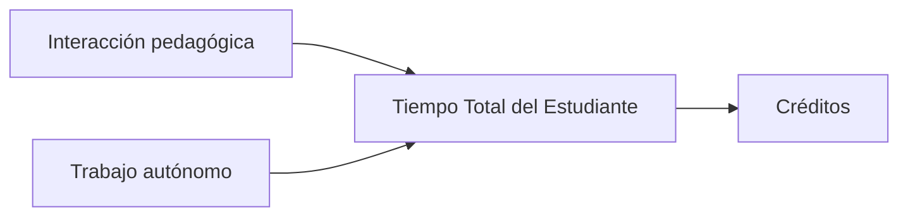

# Plan de Estudios · Programador Universitario de Sistemas

Sitio académico en español, construido con **Docusaurus 3, TypeScript y React**, para publicar el Plan de Estudios adaptado a SACAU de la Universidad Nacional de Villa Mercedes.

Incluye búsqueda local en español e inglés, Mermaid, admonitions, temas claro y oscuro, navegación jerárquica, breadcrumbs, tabla de contenidos, lectura anterior/siguiente y metadatos SEO. No utiliza blog, comentarios, publicidad ni analítica externa.

## Instalación

Requisitos: Git y Node.js 22 o superior. La versión de referencia está en `.nvmrc`.

```bash
git clone https://github.com/pu-unvime/plan-sacau-2026.git
cd plan-sacau-2026
nvm use
npm ci
```

`nvm` es opcional: puede utilizar cualquier instalación compatible de Node.js. El archivo `package-lock.json` fija las dependencias para instalaciones reproducibles.

## Ejecución local

```bash
npm start
```

Abra `http://localhost:3000/plan-sacau-2026/`. Docusaurus recarga las páginas al editar los archivos de `docs/` y los componentes.

La búsqueda local genera su índice durante la construcción de producción; para comprobarla, utilice:

```bash
npm run build
npm run serve -- --host 127.0.0.1
```

## Arquitectura y documentos originales

```text
proyecto                         Fuente original: proyecto SACAU
anexo-1-plan                     Fuente original: Anexo I
PU-Plan2026-SACAU (3).md          Fuente original: Anexo II
docs/
  index.md                       Guía de lectura
  guias/diagramas.mdx             Ejemplos SVG, React y Mermaid
  generated/                     Páginas derivadas; no editar ni versionar
i18n/es/code.json                 Traducciones del buscador local
scripts/
  content.config.mjs              Registro ordenado de fuentes
  generate-docs.mjs               Extracción de secciones y navegación
  generate-docs.test.mjs          Pruebas de integridad y generación
src/
  components/                    Componentes React reutilizables
  css/custom.css                 Paleta, tipografía y estilos globales
  generated/                     Manifiesto y sidebar generados
  pages/                         Home personalizada
static/
  img/                           SVG e imágenes públicas
  documentos/                    Copias exactas descargables generadas
site.config.ts                   Identidad institucional y URL de publicación
docusaurus.config.ts             Configuración Docusaurus
sidebars.ts                      Composición de la navegación
.github/workflows/deploy.yml      Verificación y publicación automática
```

Los **tres originales permanecen intactos**, en sus rutas iniciales. Dos no tienen extensión `.md`, pero su contenido es Markdown. El generador los lee sin sobrescribirlos y deriva:

- Un índice por documento y una página por encabezado de nivel uno, conservando el orden y el texto.
- Categorías del sidebar y accesos a los encabezados de nivel dos.
- Enlaces entre las secciones separadas, conservando sus identificadores originales.
- Definiciones de imágenes por referencia en las páginas que las necesitan, incluidas las figuras originales embebidas.
- Copias byte a byte descargables y un manifiesto con hashes SHA-256.

El contenido editorial de los documentos no se reescribe. Solo se añade metainformación a las páginas derivadas y se adaptan los enlaces internos para la navegación multipágina. Los enlaces **Editar esta página** apuntan al archivo original en GitHub, no a archivos generados.

`npm start`, `npm run typecheck` y `npm run build` regeneran el contenido automáticamente. Si modifica un original mientras está ejecutándose el servidor, ejecute `npm run content` en otra terminal.

## Desarrollo y comprobaciones

```bash
npm test
npm run typecheck
npm run build
```

Las pruebas verifican la extracción de encabezados, la conservación íntegra del texto original, las imágenes referenciadas, los destinos de navegación y las descargas exactas. La construcción falla ante enlaces Markdown, rutas internas o anclas rotas.

La fecha del footer corresponde al último commit que modificó alguno de los documentos originales, no a la fecha de construcción. GitHub Actions obtiene el historial completo para calcularla correctamente.

## Editar desde GitHub

1. Abra una página y seleccione **Editar esta página**.
2. Modifique el Markdown original o la página editorial.
3. Envíe el cambio mediante un pull request o un commit a `main`.

Los pull requests ejecutan las comprobaciones sin desplegar. Cada push a `main` publica el resultado automáticamente. Los cambios académicos deben seguir el procedimiento de revisión institucional que corresponda.

## Agregar nuevos Markdown

### Páginas independientes

Agregue archivos `.md` bajo `docs/guias/`; se incorporan automáticamente a **Recursos del sitio**:

```markdown
---
title: Nueva normativa
description: Descripción breve para buscadores.
sidebar_position: 2
---

# Nueva normativa

## Ámbito de aplicación

Contenido del documento.
```

Use carpetas y archivos `_category_.json` para crear categorías. Si la nueva página no pertenece a `guias/`, declare su documento o categoría en `sidebars.ts`.

### Nuevos originales, anexos o carreras

Agregue el archivo fuente y una entrada a `scripts/content.config.mjs` con `file`, `id`, `label` y `description`. El identificador debe ser único. Ejecute `npm run content`; los encabezados `#` crean páginas y los `##` generan subentradas. Se respetan los identificadores explícitos `{#identificador}`.

Las rutas de acceso destacadas de la carrera actual se obtienen de los encabezados **Identificación de la Carrera**, **Estructura Curricular** e **Introducción**. Si renombra esos encabezados o reutiliza el sitio para otra carrera, adapte las selecciones de `manifest.navigation` en el generador; una selección inexistente produce un error explícito.

Para una nueva carrera puede añadir fuentes con prefijos propios y agruparlas en `sidebars.ts`, o crear otro sidebar y añadir un acceso al navbar. No coloque contenido manual en `docs/generated/`, `src/generated/` ni `static/documentos/`.

## SVG e imágenes

Guarde imágenes en `static/img/`. Para un documento directamente bajo `docs/`:

```markdown

```

Desde `docs/guias/`, utilice `../../static/img/estructura.svg`. El texto alternativo debe describir la imagen. Docusaurus adapta las rutas al subdirectorio de publicación.

Para incrustar un SVG como componente React, utilice `.mdx`:

```jsx
import Estructura from '@site/static/img/estructura.svg';

<Estructura role="img" aria-label="Estructura curricular" />
```

SVGR está incluido en el preset. Se desactiva SVGO para conservar los grupos y atributos usados por las interacciones. Los archivos `.md` se procesan como Markdown y `.mdx` permite JSX, por lo que los documentos académicos no necesitan adaptar su sintaxis a React.

`src/components/InteractiveStructure/` incluye un ejemplo funcional con selección y resaltado mediante CSS, enlaces internos y zoom accesible mediante teclado. Los atributos `data-stage` de los grupos del SVG permiten incorporar nuevas interacciones sin duplicar identificadores en el documento ni cambiar la configuración de compilación. No importe SVG de fuentes no confiables ni archivos con scripts.

## Mermaid y avisos

Utilice bloques con el lenguaje `mermaid` en Markdown:

````markdown

````

El tema se adapta al modo claro y oscuro. Mermaid utiliza `securityLevel: 'strict'`; no habilite HTML arbitrario para incorporar interactividad.

Los avisos están disponibles sin plugins adicionales:

```markdown
:::info Nota académica
Información complementaria para la lectura.
:::
```

La guía **Diagramas, SVG y Mermaid** ofrece ejemplos de flujos, trayectorias, correlatividades y procesos administrativos. Son ilustrativos: no agregan normativa ni relaciones curriculares a los originales.

## Branding y SEO

- **Institución, carrera, repositorio y publicación:** `site.config.ts`.
- **Azul institucional, grises y tema oscuro:** `src/css/custom.css`.
- **Home:** `src/pages/index.tsx` y `index.module.css`.
- **Isotipo:** `static/img/favicon.svg`.
- **Navbar, footer, metadatos, imagen social y Mermaid:** `docusaurus.config.ts`.
- **Descripción de cada página:** campo `description` de su front matter.

Se usan fuentes de sistema: no se descargan tipografías de terceros. Los enlaces externos del footer no cargan servicios de analítica.

## Publicación en GitHub Pages

Configuración de este repositorio:

```ts
export const ORGANIZATION_NAME = 'pu-unvime';
export const PROJECT_NAME = 'plan-sacau-2026';
export const SITE_URL = `https://${ORGANIZATION_NAME}.github.io`;
export const BASE_URL = `/${PROJECT_NAME}/`;
```

La URL prevista es `https://pu-unvime.github.io/plan-sacau-2026/`.

El workflow `.github/workflows/deploy.yml` instala mediante `npm ci`, ejecuta pruebas y TypeScript, construye el sitio, genera el índice local y publica el artefacto con las acciones oficiales de Pages. No requiere secretos personalizados, una rama `gh-pages` ni comandos de despliegue locales. El despliegue usa permisos mínimos `pages: write` e `id-token: write` solo en el job de publicación.

El repositorio debe tener habilitado **GitHub Pages con origen GitHub Actions**. La activación inicial requiere permisos de administración y no puede realizarse con el `GITHUB_TOKEN` del workflow. Un administrador debe habilitar ese origen una única vez en **Settings → Pages → Build and deployment → Source → GitHub Actions**, o mediante la API con una credencial autorizada. Después, cada push a `main` publica sin intervención manual. El mismo requisito se aplica al reutilizar el proyecto en otro repositorio.

Para un dominio propio, cambie `SITE_URL`, ajuste `BASE_URL` a `/` si corresponde y agregue `static/CNAME`. Para un repositorio llamado `<organización>.github.io`, utilice también `BASE_URL = '/'`.

## Solución de problemas

| Problema | Solución |
| --- | --- |
| Node.js no compatible | Use `nvm use` o instale Node.js 22 o superior. |
| No existen `src/generated/` o `docs/generated/` | Ejecute `npm run content`; los comandos principales lo hacen automáticamente. |
| La búsqueda no devuelve resultados en desarrollo | Ejecute `npm run build` y `npm run serve`; el índice es de producción. |
| Se ven enlaces o recursos con 404 en Pages | Compruebe `SITE_URL`, `BASE_URL` y las mayúsculas de los nombres. Evite rutas HTML absolutas escritas a mano; use `Link` o `useBaseUrl` en React. |
| Falló la construcción por enlaces rotos | Revise el encabezado o archivo citado. No desactive la validación para ocultar el error. |
| Una figura original no aparece | Mantenga su definición de referencia y ejecute las pruebas; el generador copia las definiciones necesarias a cada sección. |
| Cambió el original, pero no la página local | Ejecute `npm run content` con el servidor activo o reinicie `npm start`. |
| La página generada pierde cambios manuales | Edite la fuente original; los directorios generados se reconstruyen siempre. |
| Un componente no funciona dentro de `.md` | Cambie únicamente la página técnica a `.mdx`; no convierta los originales. |
| Error de Pages por sitio inexistente o permisos | Confirme el origen GitHub Actions, que Actions esté permitido y los permisos del job `deploy`. |
| Falla el cálculo de última actualización | Use un clon Git con historial de los archivos fuente; el workflow ya usa `fetch-depth: 0`. |
| Caché de desarrollo desactualizada | Ejecute `npm run clear` y reinicie el servidor. |

No se declara una licencia sobre los documentos originales: su autoría y régimen de uso permanecen bajo la institución.
