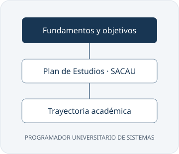
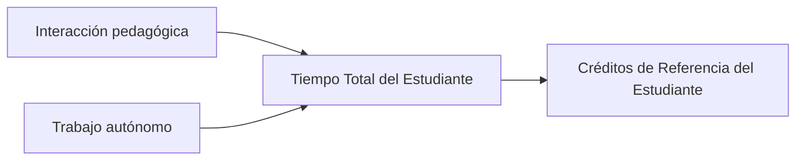
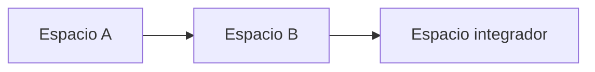
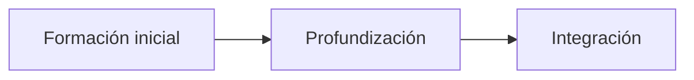
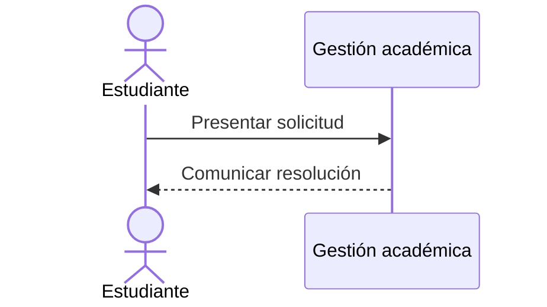

import Estructura from '@site/static/img/estructura.svg';
import InteractiveStructure from '@site/src/components/InteractiveStructure';

# Diagramas, SVG y Mermaid

:::caution Ejemplos ilustrativos
Los diagramas de esta guía demuestran las capacidades del sitio. No establecen correlatividades, equivalencias ni procedimientos oficiales. Consulte siempre los documentos académicos.
:::

## SVG estático en Markdown

Guarde imágenes en `static/img/`. Para una página ubicada directamente en `docs/`, la ruta relativa es `../static/img/estructura.svg`; desde una subcarpeta como esta guía, utilice `../../static/img/estructura.svg`.

```markdown

```



Incluya siempre un texto alternativo descriptivo. Docusaurus resuelve las imágenes teniendo en cuenta el subdirectorio de GitHub Pages.

## SVG como componente React

En un archivo `.mdx` o un componente `.tsx` puede importar el SVG mediante SVGR, incluido en el preset de Docusaurus:

```jsx
import Estructura from '@site/static/img/estructura.svg';

<Estructura role="img" aria-label="Organización de la documentación" />
```

<Estructura role="img" aria-label="Organización de la documentación" style={{maxWidth: 420, width: '100%', height: 'auto'}} />

Use `.md` para contenido Markdown normal y `.mdx` cuando necesite componentes React.

## SVG interactivo

Este componente permite resaltar elementos con CSS, navegar mediante enlaces y aplicar zoom. Los controles funcionan con teclado; el área del gráfico permite desplazamiento cuando se amplía.

<InteractiveStructure />

La implementación está en `src/components/InteractiveStructure/`. Los grupos SVG tienen atributos `data-stage` estables (`fundamentos`, `plan`, `trayectoria`), que permiten seleccionar elementos sin duplicar identificadores cuando el diagrama aparece varias veces. La optimización SVGO está desactivada para conservar estos grupos y atributos interactivos. Para futuros diagramas puede agregar enlaces `<a>` dentro del SVG con nombres accesibles; en React use `Link` para resolver rutas internas bajo `baseUrl`.

:::warning Seguridad de los SVG
Use archivos propios o de fuentes confiables. No incorpore scripts, manejadores de eventos ni referencias remotas en SVG aportados por terceros.
:::

## Mermaid

Los bloques `mermaid` se renderizan automáticamente en los temas claro y oscuro.

### Flujo de créditos SACAU



### Correlatividades ilustrativas



### Trayectoria curricular ilustrativa



### Proceso administrativo ilustrativo



## Avisos y tablas

```markdown
:::info Título del aviso
Contenido del aviso.
:::
```

Los encabezados de nivel dos y tres alimentan automáticamente la tabla de contenidos. Use tablas Markdown para datos y bloques de código con lenguaje explícito para ejemplos técnicos.
